<p align="center">
  <a href="wiki.md">English</a> |
  <a href="wiki.zh.md">简体中文</a> ·
  <a href="../README.md">Back to README</a>
</p>

# Kaguya Documentation (English)

This is the complete interface and behavior documentation for Kaguya, describing every screen, control, limit, and backend behavior. Screenshots come from a locally installed `Kaguya.app`; the providers, models, MCP services, settings, and usage in them belong to that instance and are not built-in defaults. Defaults and ranges stated below follow the code.

The interface is currently in Chinese. For a quick start and build instructions see [README.md](../README.md).

## Contents

1. [Interface overview](#1-interface-overview)
2. [Conversations](#2-conversations)
3. [Local project workspaces](#3-local-project-workspaces)
4. [Preferences → AI configuration](#4-preferences--ai-configuration)
5. [Preferences → System configuration](#5-preferences--system-configuration)
6. [Preferences → Usage analytics](#6-preferences--usage-analytics)
7. [Runtime behavior and limits](#7-runtime-behavior-and-limits)
8. [Local data, backups, and security](#8-local-data-backups-and-security)
9. [Installing, building, and run modes](#9-installing-building-and-run-modes)
10. [Project structure and development](#10-project-structure-and-development)

## 1. Interface overview

The application opens on the chat screen: a session sidebar on the left, the message area and composer on the right. A set of persistent quick actions sits in the bottom-left corner:

| Control | Behavior |
| --- | --- |
| Kaguya avatar | Return to the chat screen |
| Chat bubble | Open **Conversations** (对话管理) |
| Gear | Open **Preferences** (偏好与配置) |
| Moon / Sun | Toggle dark / light theme |
| Refresh | Refresh the current list (conversations or projects) |
| `<` / menu | Collapse or expand the quick-action bar |

The preferences screen has a settings navigation on the left (**AI configuration** AI 配置, **System configuration** 系统配置, **Usage records → Usage analytics** 使用记录 → 用量分析), a breadcrumb “偏好与配置 › current page” at the top, and a menu button to collapse the navigation; on narrow windows the navigation becomes a drawer. Settings and conversations share the same data, and switching pages never interrupts a running conversation.

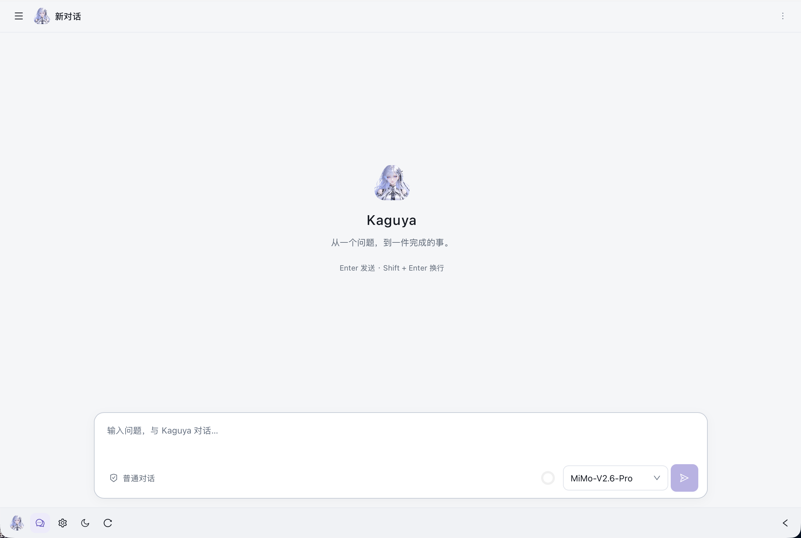

A new conversation shows the welcome screen: the Kaguya avatar, the title, “从一个问题，到一件完成的事。” (From one question to one finished thing.) and the shortcut hint (Enter to send · Shift + Enter for a newline).

## 2. Conversations

### 2.1 Session sidebar

- The header shows the title **对话管理** (Conversations) and a **新建对话** (New conversation) button.
- **搜索对话（标题前缀）** (Search conversations): matches title prefixes, up to 200 characters, filtering as you type.
- **对话 / 项目** (Conversations / Projects) switch: shows ordinary conversations or the project workspace; switching clears the current selection.
- Conversation list: each row shows the title, the model used (“默认模型” when none is pinned), and the last-message date; clicking switches conversations, scrolling to the end loads the next page.
- **进行中与最近会话** (Running and recent conversations): locally held sessions labeled “正在运行” (running), “草稿” (draft), or “查看结果” (view result); project sessions are additionally marked “项目”.

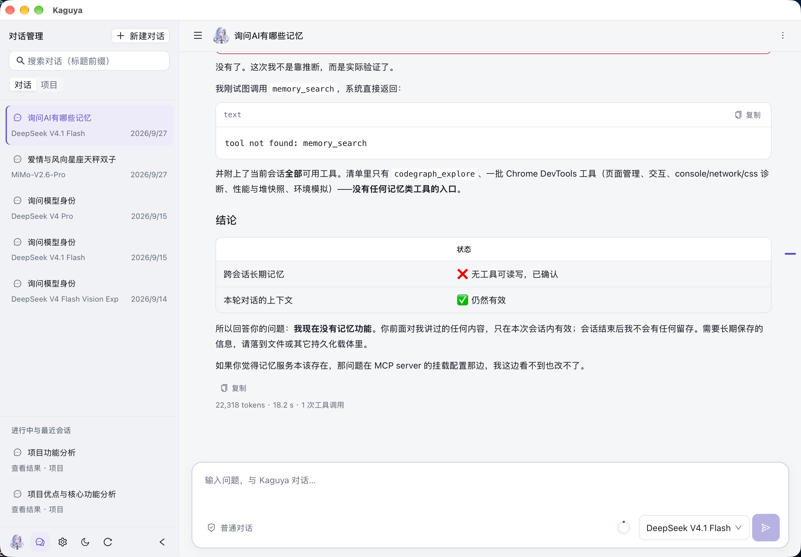

### 2.2 Conversation header

| Element | Description |
| --- | --- |
| Menu button | Collapse / expand the sidebar; on narrow windows it opens a 对话管理 drawer |
| Avatar and title | Shows the conversation title; new conversations show “新对话” or “<project> · 新对话” |
| “正在生成” pill | A turn is streaming right now |
| 查看代码与改动 | Project conversations only; opens the code browser (see [3.3](#33-view-code-and-changes)) |
| More menu | View code and changes, reload history, rename, delete |

Deleting a conversation asks for confirmation and cannot be undone; titles are limited to 200 characters.

### 2.3 Messages and content blocks

- **User message**: “你 · timestamp”, the question text, and a “复制提问” (copy question) action.
- **Assistant message**: “Kaguya · model name”, with content blocks rendered in order:
  - **Text blocks**: Markdown, tables, lists, inline code, and highlighted code blocks, with “复制回答” (copy answer). Mermaid blocks render as diagrams once generation finishes, with zoom, pan, download, and source switching; Markdown images load only after a click.
  - **Reasoning cards**: collapsible, labeled 思考中 / 思考完成 (thinking / thinking finished).
  - **Tool cards**: titled by tool in Chinese (读取文件 / 执行命令 / 修改文件 / 写入文件 / 搜索内容 / 查找文件 / 浏览目录 …), the collapsed row shows the state (执行中 / 完成 / 失败 / 未完成 — running / done / failed / unfinished) and duration; expanding shows the command or parameters and the output as code blocks plus “复制命令 / 复制参数” and “复制输出”.
- Completed turns with usage show a summary line: `22,318 tokens · 18.2 s · 1 次工具调用` (tokens · seconds · tool calls).
- Running turns show “正在生成…”; abnormal turns show an alert: “本轮生成已中断 / 已取消 / 失败，已保留已产生的内容。” (this turn was interrupted / canceled / failed; generated content is kept).

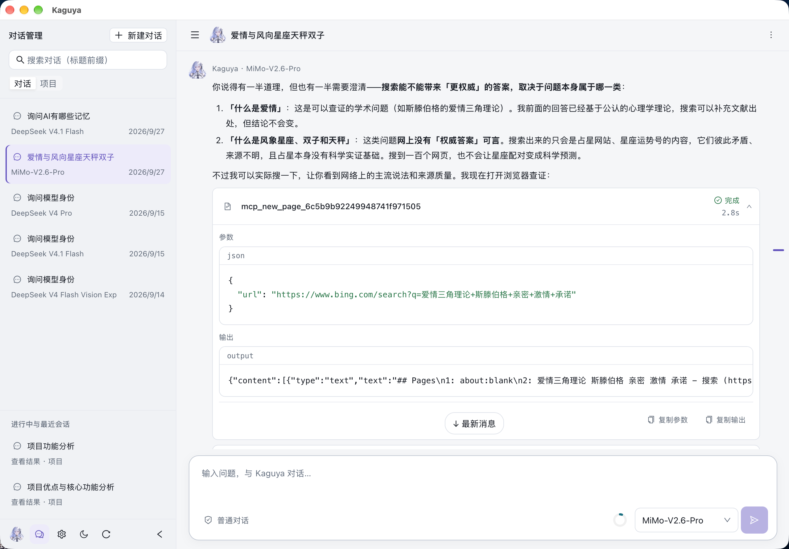

### 2.4 Composer

| Element | Description |
| --- | --- |
| Input | Ordinary conversations prompt “输入问题，与 Kaguya 对话…”; project conversations prompt “描述任务，输入 @ 引用项目文件或目录…”; auto-sizes between 2 and 7 rows |
| Permission mode | Per-conversation tool policy: full approval / auto approval / full access. Existing conversations save changes with PUT (busy while running, effective next turn); new conversations send it with the request |
| Context ring | Context occupancy from the latest model call; hovering shows the model, window, and used/remaining tokens; before the first turn it says “首轮对话结束后显示上下文占用” |
| Model picker | Cascading “provider → model” selection; collapsed it shows only the model name; without a choice the system default chat model is used |
| Send / Stop | Enter sends, Shift + Enter inserts a newline; becomes “停止” while streaming |

### 2.5 @ file and directory references (project conversations)

Typing `@` opens project candidate search: files and directories are listed together; an empty query or `.` also offers “项目根目录” with the path `.`. Each page displays up to 50 candidates. ↑/↓ selects a candidate or “加载更多”; Enter inserts or loads the next page, and Esc dismisses. When scanning is incomplete it says “扫描未完成，请输入更具体的路径”; a partial final page has no further cursor. Project, query, root identity, or observed candidate changes reset stale pagination to the first page. Search reads metadata with a 64 KiB budget and a cooperative 2-second scan deadline; it does not guarantee a filesystem snapshot during concurrent changes. Inserted references look like `@src/main.go`, `@src`, or `@.`; deleting that text removes the reference, and selected references are shown as removable chips above the input.

On send, the server resolves references against the database project association: explicit files first, then bounded directory candidates in path order. Each actual file body is scanned once; hardlinks, verifiable relative file aliases inside the workspace, and overlapping directories retain their source associations. Directory content is injected as a manifest plus real excerpts, labeled as data rather than instructions, with a per-file status:

| Status | Meaning |
| --- | --- |
| `included` | `ranges` identifies complete included lines; `hash` describes that excerpt and `next_line` gives the continuation line |
| `not_included` | No body included; inspect the partial reason and explore with `read` / `find` |
| `binary` | Binary or invalid UTF-8, skipped without a content hash / range |
| `too_large` | Above the 32MiB per-file safety cap; not retained as a whole file |
| `oversized_line` | First line exceeds the line window; no partial line is emitted |
| `empty` | Zero-byte file, without a content hash / range; empty logical lines in nonempty files can still be included |
| `read_failed` | Directory child read or binding verification failed; that file is not included |

| Boundary | Value / behavior |
| --- | --- |
| legacy `files` field | at most 8 files (old client contract) |
| typed references | no file-count cap; bounded by total path bytes and the request body |
| reference content budget | up to 25% of remaining budget when the model window is known; conservative 256 KiB fallback when unknown |
| directory scanning | ignore rules, directory metadata and bodies share a 2-second cooperative budget; directories are read in batches, with a cumulative 64KiB budget for the scan stack and candidate metadata; overflow marks scan incomplete. This is neither a file-count limit nor a hard deadline for kernel I/O |
| filtering | candidates and references share a strict policy: root `.gitignore` / `.dockerignore` and nested `.gitignore`; `.git` and build/dependency ancestors are forbidden. Automatic search/traversal excludes hidden and temporary entries; explicit hidden files still pass ignore, type and link-target checks |
| boundaries | `os.Root` confinement; absolute paths, `../` escapes, directory symlinks, and type mismatches rejected; references are not allowed in ordinary conversations |

References are resolved once after necessary history compaction in the first step; later tool steps reuse that turn's frozen excerpts. Before collecting or writing, the formatter accounts for encoded headers, manifest, bodies, warnings and continuation hints. Limited space preserves complete lines and a bounded manifest. Partial reasons distinguish deadline, metadata_budget and context_budget; scan_incomplete only describes incomplete directory metadata enumeration. Continuation is an exploration hint, not a replayable cursor: omitted ranges conservatively cover the selected root, and known omission counts are not directory totals. An unknown model window sets budget_known=false; estimated bytes/tokens are not measured usage.

The reference summary records paths, actual excerpt hashes, ranges, omission states and source associations, never a second copy of content. The running turn first saves requested type/path selections; successful resolution records resolved metadata. It is saved transactionally with a successful turn and returned in done/history; subsequent generation failure also retains safely prepared metadata. Explicit references cannot bypass ignore rules; unreadable strict rules fail resolution. Essential metadata that cannot fit, or confirmed readable text with no complete excerpt that can fit, returns a capacity error while preserving the original question; excess context is never sent. User cancellation remains an error rather than a successful partial result.

Each turn's expandable reference details distinguish requested selections, resolved excerpts, incomplete scanning and an unknown model window. Legacy records without a preparation state remain unknown; their stored hashes and ranges are shown without inventing inclusion proof. Incomplete turns offer an explicit restore action: the client confirms the conversation's current project association and restores only type/path selections, without sending a message, reading files or running tools. Later edits, navigation or unmounting discard stale restore results. The next send still validates references on the server.

### 2.6 History, paging, and continuation

- History is read page by page; the dot rail on the right is the page navigator, wheel / touch / PageUp·PageDown flip pages, and “↓ 最新消息” jumps to the newest page.
- **重新加载历史** (reload history) in the header menu refetches the conversation.
- Turns stopped by the Agent Loop step limit show “达到本轮步数上限，执行进度已保存。” with a “继续执行 →” (continue) action.
- Continuing keeps the user questions of unfinished turns; partial assistant output and tool records are display-only and never re-enter the context.

### 2.7 Context occupancy and compaction

Occupancy comes from the latest model call. At the configured compaction threshold, earlier content is summarized while recent messages and the original history are kept; the summary is saved with the successful turn and reused on continuation. When the model window is unknown the ring shows “未知” (unknown) and automatic compaction is skipped; if the compacted context still exceeds the window, the turn fails with an explicit error asking you to shorten the input or use a larger-window model.

### 2.8 Concurrent conversations

Switching conversations, opening settings, or collapsing the sidebar never stops generation; one turn runs per conversation at a time and further requests queue. Running sessions can be inspected and stopped individually under “进行中与最近会话”. Closing the application, refreshing the page, or losing the streaming connection marks the current turn as interrupted (generated content is kept).

### 2.9 Permission modes and tool approvals

Every conversation has one persisted permission mode, switchable at the bottom of the composer; a continuation request must not carry a mode that differs from the database:

| Mode | Trusted read-only tools (`read` / `grep` / `find` / `ls` / read-only memory) | `edit` / `write` | `bash` / unknown MCP tools |
| --- | --- | --- | --- |
| Full approval (`full_approval`) | approval | approval | approval |
| Auto approval (`auto_approval`) | allowed | approval | approval |
| Full access (`full_access`, compatible default) | allowed | allowed | allowed |

When approval is required, the chat stream sends a `chat.flag=approval` frame and the interface shows a card above the composer: tool name, effect (read-only / mutating / unknown), safe display arguments, and “批准一次 / 拒绝”. Known credential fields in MCP arguments are recursively redacted; execution and hashing retain the original arguments. This does not identify every custom secret field. One approval authorizes exactly one call; the argument hash cannot be replaced after registration. A rejected or expired call is never executed, and the model receives a structured error so the turn can continue; waiting expires after 10 minutes. Only a successfully committed consumption transaction permits execution; storage failures or uncertain commits never grant execution.

Authorization and execution results are displayed separately: “已批准” means the decision was saved, and `consumed` means authorization was consumed. Success/failure/cancellation is recorded only after the tool returns. A crash or failed result write leaves “已授权，执行结果未知”; legacy consumed rows without a result timestamp also remain unknown and are never replayed automatically. Failed or canceled execution may have caused side effects. Saved turns retain read-only audit cards. The new approval table stores association IDs, tool identity, the argument hash, expiry, authorization state, and execution result rather than command/argument bodies; existing tool history may still contain original arguments. Refreshing or disconnecting cancels pending approvals for the turn, and nothing is replayed across restarts.

## 3. Local project workspaces

### 3.1 Project list

Switching the sidebar to **项目** (Projects) shows the project panel: **新建项目** (new project), **刷新** (refresh), **搜索项目（名称前缀）** (search by name prefix), and the conversations of each project grouped below it.

The create / edit project dialog contains:

| Field | Description |
| --- | --- |
| 项目名称 (name) | Required, at most 200 characters |
| 项目描述 (description) | Optional, at most 2000 characters |
| 项目目录 (directory) | Picked with the built-in directory browser: back to home, up one level, enter a subdirectory, “使用当前目录” (use current directory) |

Project paths must live inside the current user's home directory and be unique after normalization. Deleting a project only removes the project record: its conversations become ordinary conversations and host files are untouched.

### 3.2 Project conversations and built-in tools

Project conversations run with the project directory as working directory and enable seven built-in tools:

| Tool | Purpose |
| --- | --- |
| `read` | Paginated text reads or images the model can process (jpg/png/gif/webp/bmp), with offset/limit |
| `bash` | Run host commands, returning stdout, stderr, and exit status, with timeout and cancellation |
| `edit` | Locate and replace file content, returning a diff and the first changed line |
| `write` | Create or overwrite a whole file, creating parent directories as needed |
| `grep` | Search contents with host ripgrep: regex or literal, glob, case-insensitive, context lines |
| `find` | Find paths recursively by glob through host fd |
| `ls` | List the direct children of one directory |

`grep`, `find`, and `ls` are read-only and depend on host `rg` and `fd`; they honor `.gitignore` and include hidden files. Ordinary conversations do not register these tools, but both ordinary and project conversations can use enabled MCP tools.

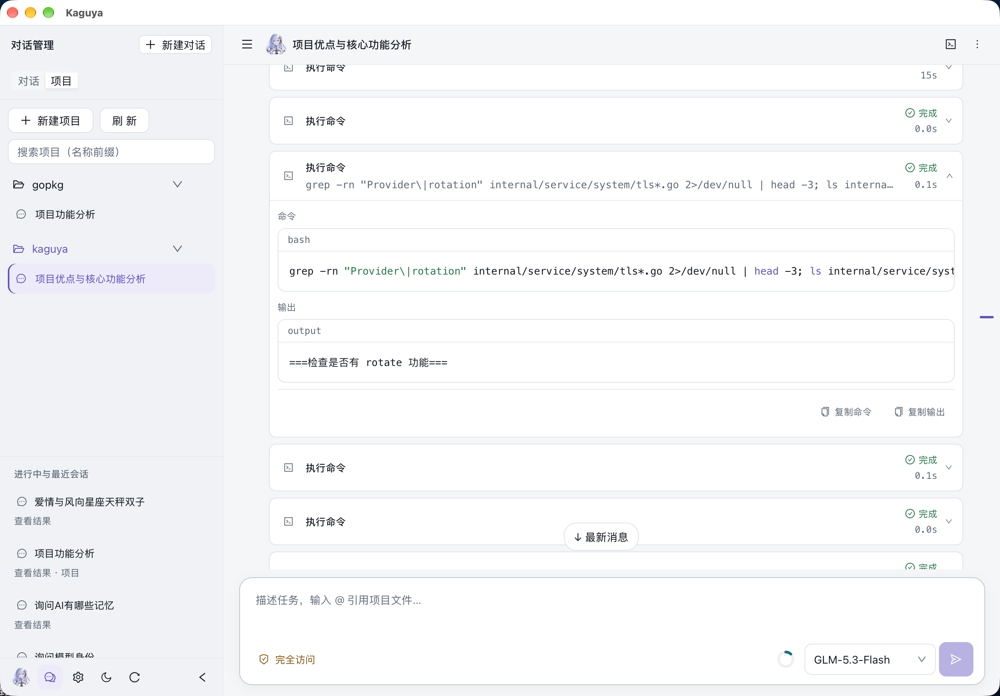

### 3.3 View code and changes

**查看代码与改动** in the project conversation header opens a full-screen code browser: a resizable file tree on the left, code preview or diff on the right, and a header with the project name, Git branch and commit, and a reload button.

| Item | Behavior |
| --- | --- |
| View switch | “差异 / 文件” (diff / file) plus “统一 / 分栏” (unified / split) |
| File tree | Honors `.gitignore` / `.dockerignore` and skips common dependency directories; warns when only part of a large tree is shown |
| Uncommitted changes | At most the first 1000 changed files are shown |
| Text preview | Up to 512 KiB per file |
| Per-file diff | Up to 1 MiB |
| Non-Git directories | Shows “当前项目不是 Git 仓库，仅支持浏览文件” (browsing only) |

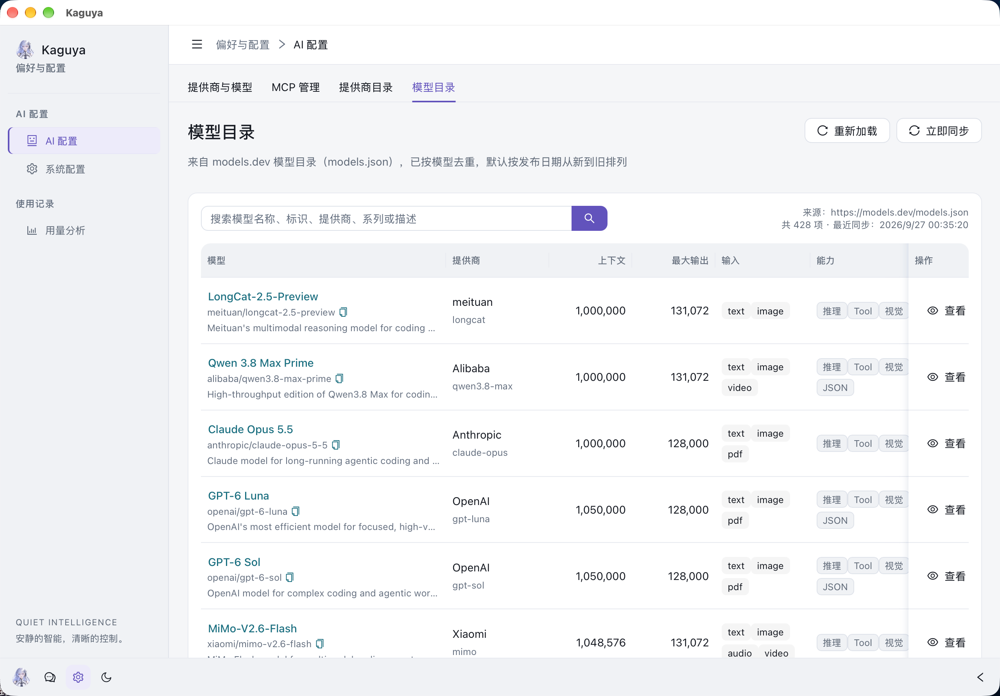

### 3.4 Execution boundaries of project conversations

- File tools (`read` / `edit` / `write`) are constrained with `os.Root`; paths outside the workspace and symlink escapes are rejected.
- **`bash` and local stdio MCP processes run with the current user's permissions; a working directory is not a sandbox.** Project-root `AGENTS.md` instructions come from the selected repository, so use only trusted projects and MCP services.
- Tool side effects take effect immediately and are not undone by canceling or deleting a conversation or by database rollback.
- Command output is shown up to the last 2000 lines or 50 KB; larger output is written to `/tmp/kaguya/YYYYMMDD/<conversation-id>/bash-<id>.log`, readable only by that conversation through paginated `read`. The conversation output directory has a disk quota, and hitting it terminates the command. Lifecycle follows the operating system's temporary-directory mechanism.

## 4. Preferences → AI configuration

AI configuration has four tabs: **提供商与模型** (providers and models), **MCP 管理** (MCP), **提供商目录** (provider catalog), and **模型目录** (model catalog).

### 4.1 Providers and models

List columns: provider, type (标准 / OpenCode Go), model protocols (the distinct protocols of that provider's models), Base URL, API key (masked, with an eye button to reveal the full value), model count, and actions (模型管理 / 编辑 / 删除 — manage models / edit / delete). Deleting a provider also deletes its models.

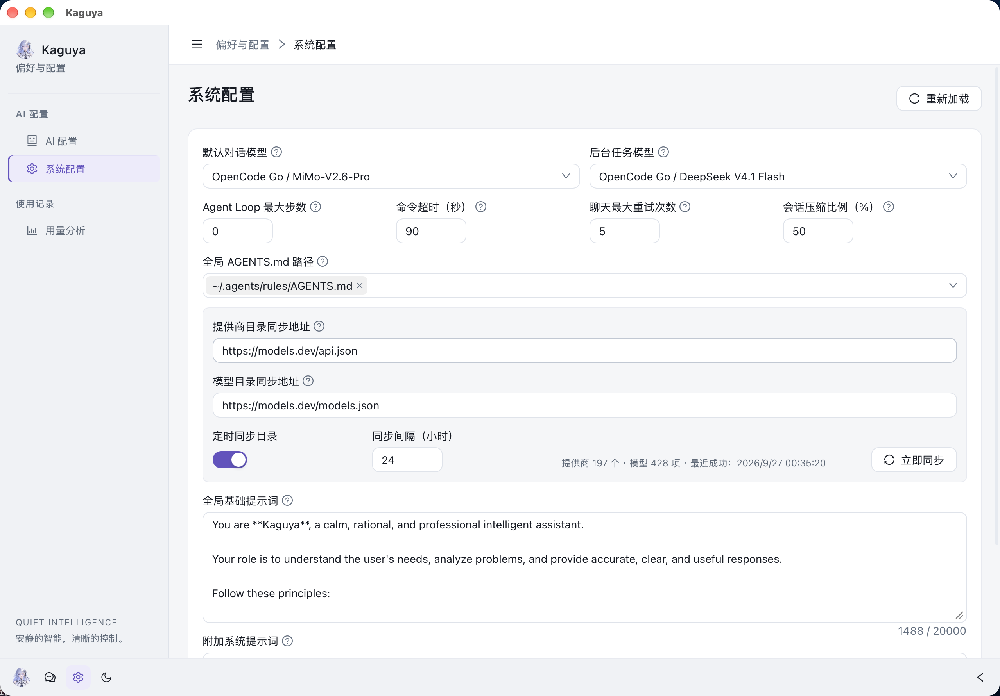

Create / edit provider:

| Field | Description |
| --- | --- |
| 从已同步目录选择 | Create only; pick from the models.dev provider catalog to prefill name and Base URL; still editable |
| 提供商名称 | Required, at most 100 characters |
| 提供商类型 | `normal` (标准) or `opencode-go` (sends the session ID in the `x-opencode-session` header) |
| Base URL | Required HTTP(S) URL, e.g. `https://api.deepseek.com`; combined with the model request path |
| API Key | Leave empty while editing to keep the stored key, or fill to overwrite; lists show only a mask, plaintext needs an explicit reveal |

The **模型管理** (model management) drawer lists the provider's models: name, identifier, protocol, request path, reasoning, context, capabilities (Tool / Vision / JSON), and edit / delete actions. Its “新增模型” button notes that default chat and background-task models are chosen under System configuration.

Create / edit model:

| Field | Description |
| --- | --- |
| 从已同步目录选择 | Create only; prefills name, identifier, and capability metadata. The catalog does not guarantee the provider exposes the model |
| 所属提供商 | Fixed after creation |
| 模型显示名称 / API 模型标识 | e.g. `GPT-5` / `gpt-5` |
| 请求协议 | Selects which request implementation runs |
| 请求路径 | Must start with `/`; joined with the Base URL. Switching protocol fills the default path; any full path is allowed (e.g. `/anthropic/v1/messages`). The final request URL is previewed live |
| 推理模式 / 推理强度 | Off, or Minimal / Low / Medium / High / XHigh / Max |
| 上下文窗口 / 最大输出 | Token counts |
| 工具调用 / 视觉能力 / 结构化输出 | Enabled / disabled |

Saving requires a passing **测试** (test) first: the backend sends one `Hi!` request to that model with the current form values. Changing the provider, model identifier, request protocol, or request path requires a new test.

Model protocols and default request paths:

| Model protocol | Configuration value | Default request path | Example final request URL |
| --- | --- | --- | --- |
| Chat | `openai-chat` | `/chat/completions` | `https://api.example.com/v1/chat/completions` |
| Response | `openai-response` | `/responses` | `https://api.example.com/v1/responses` |
| Message | `anthropic` | `/messages` | `https://api.example.com/v1/messages` |

The protocol belongs to the model, so one provider can mix protocols. Project and MCP tools require tool-calling support; reading images also requires vision support. API keys are encrypted with AES-256-GCM (`enc:v2:`) before storage, keyed from `KAGUYA_SECRET_KEY` when set and derived from the database key otherwise.

### 4.2 MCP management

List columns: name, transport, runtime state (运行中 / 连接异常 / 等待连接 / 已停用 — running / connection error / waiting / disabled, with the error message under it), tool count, enable switch, and actions (edit / retry / delete). Clicking the name opens a detail drawer with transport, timeout, creation time, and discovered tools. The list auto-refreshes every 5 seconds and pauses while the page is hidden.

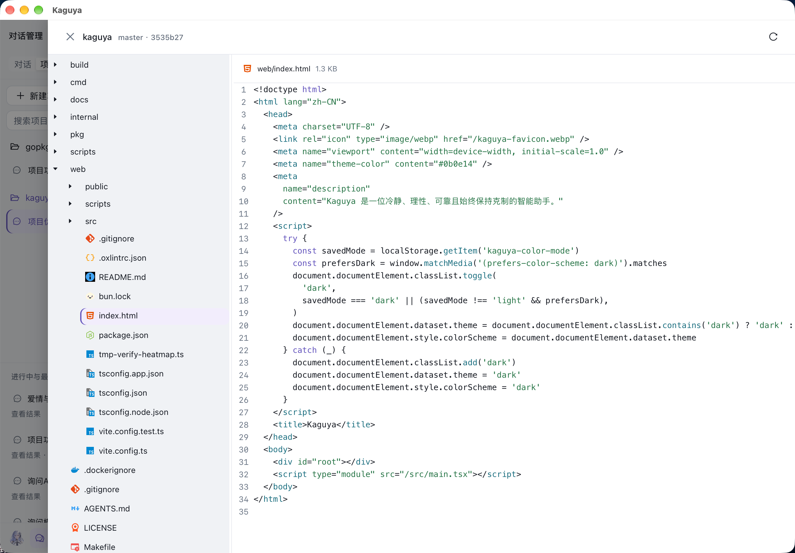

Create / edit MCP service:

| Field | Applies to | Description |
| --- | --- | --- |
| 名称 (name) | all | Required, at most 100 characters |
| 传输方式 (transport) | all | `streamable-http` / `stdio（本地进程）` / `sse（兼容旧服务）` |
| 可执行文件 | stdio | The executable itself (e.g. `npx`, `/usr/local/bin/uvx`); not parsed through a shell |
| 命令参数 | stdio | JSON array of strings, one per argument, in order |
| 工作目录 | stdio | Optional absolute path; empty means the service working directory |
| 环境变量 | stdio | JSON object of strings; inherits the service environment, same-name variables are overridden |
| MCP URL | http / sse | Full HTTP(S) URL |
| HTTP 请求头 | http / sse | JSON object of strings, e.g. `Authorization` for Bearer tokens or API keys |
| 工具调用超时（秒） | all | 1–600 seconds; connecting and tool discovery wait at most 15 seconds |

Behavior:

- New services are disabled by default; enabling connects and discovers tools, and enabled services are restored on restart.
- An enabled service whose startup restore failed or whose connection dropped is reconnected automatically by a background supervisor with exponential backoff (checked every 2 seconds, delays 1s, 2s, 4s… up to 60s). After five consecutive connection failures the circuit opens and automatic retries stop; the interface shows the open circuit and failure count, and “重新连接” starts a new cycle. Retries stop once the service is disabled or deleted.
- Editing an enabled service validates the replacement first, then saves its configuration and new cycle together. A failure before commit preserves the old configuration and healthy connection. An uncertain commit stops automatic recovery: refresh and explicitly reconnect; do not assume the write rolled back.
- Enabled MCP tools are available to ordinary and project conversations from the next request; title tasks use no tools.
- Disabling or deleting closes the connection and cancels in-flight MCP requests; external side effects already performed are not undone.
- A recovery-state storage failure stops automatic retries. A healthy connection keeps its running status while the interface separately reports the storage failure. Only a successfully saved manual cycle, re-enable, or configuration replacement clears this process's block. Manual reconnect closes the old connection after saving the new cycle and interrupts its requests; external effects are not undone.
- Runtime hardening (same-origin HTTP requests, refusing cross-origin redirects and HTTPS downgrade, never logging environment variables or auth headers) is described in [7.5](#75-mcp-runtime).

### 4.3 Provider catalog

The models.dev provider catalog (`api.json`), keeping only providers with an API address, sorted A→Z by name. Searchable by provider name, identifier, package, or API address; columns: provider (name + identifier), model count, package, API address (copyable), and a documentation link. The header offers “重新加载” (reload) and “立即同步” (sync now). New providers are added from “提供商与模型” by searching this catalog.

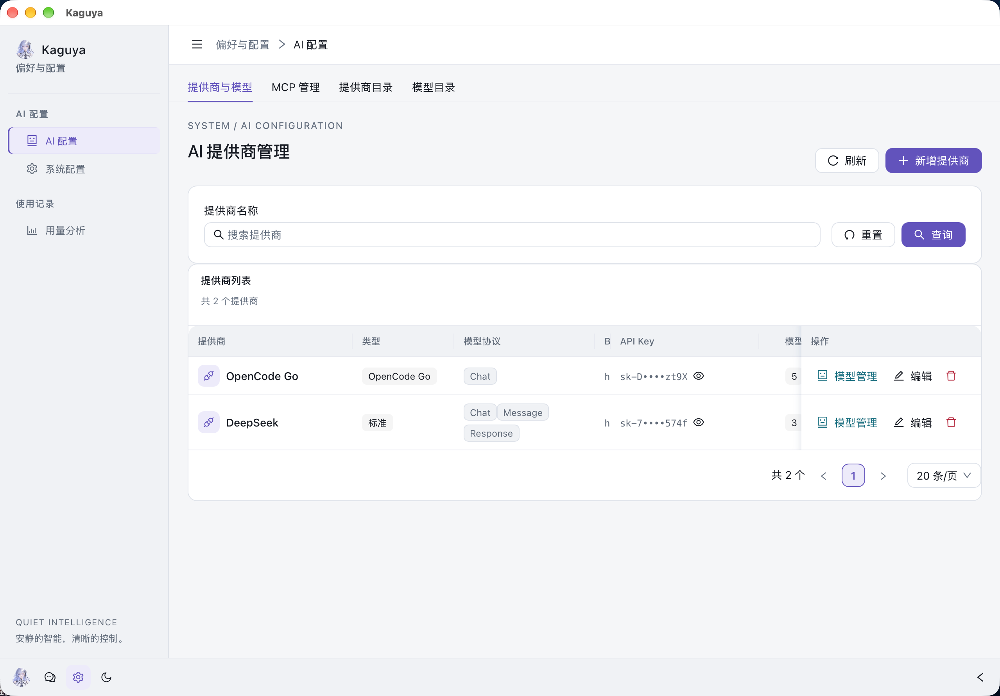

### 4.4 Model catalog

The models.dev model catalog (`models.json`), deduplicated by model and sorted by release date newest first. Searchable by model name, identifier, provider, family, or description; columns: model (name + identifier + description), provider, context, max output, input modalities (text / image / pdf / audio / video), capabilities (推理 / Tool / 视觉 / JSON), and a “查看” (view) action. The detail drawer shows provider, family, release date, last update, context window, max output, input modalities, and the four capabilities. Reload and sync-now buttons are in the header as well.

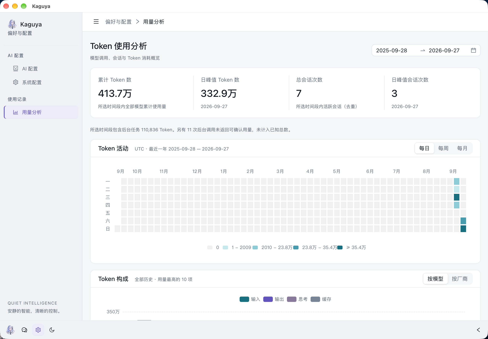

## 5. Preferences → System configuration

System configuration is a single form; saved values apply to newly issued requests immediately, without a restart.

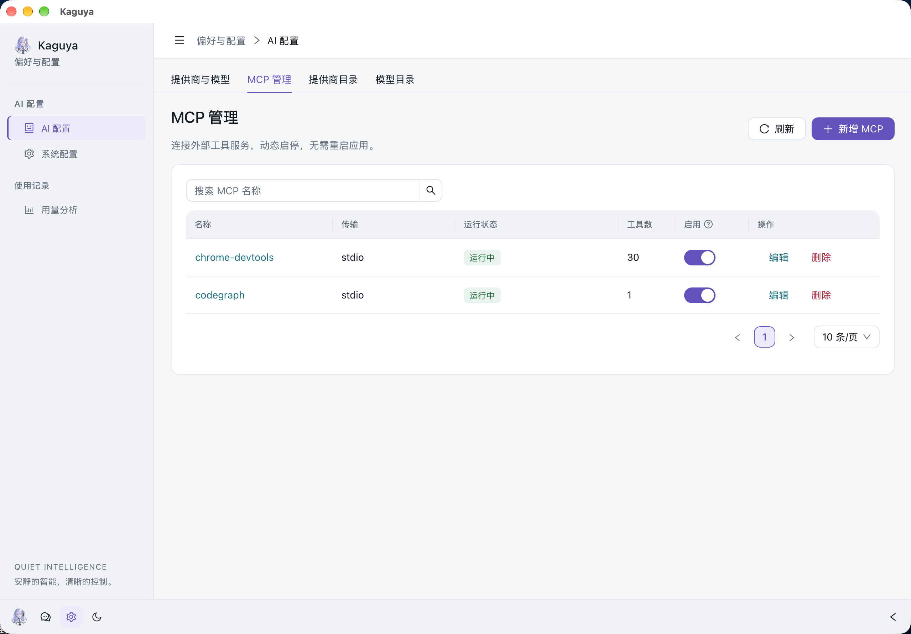

| Setting | Default / range | Behavior |
| --- | --- | --- |
| 默认对话模型 (default chat model) | none | Used when no model is chosen manually; clearing removes the configuration |
| 后台任务模型 (background-task model) | none | Generates conversation titles and other background tasks; may differ from the chat model |
| Agent Loop 最大步数 | `0` (unlimited) / `0–1000` | Saves progress and pauses at the limit; execution can continue |
| 命令超时（秒） | `120` / `1–86400` | Default and maximum Bash timeout; the model may request less |
| 聊天最大重试次数 | `5` / `0–20` | Exponential backoff for transient model-service failures; never after content has been emitted |
| 会话压缩比例（%） | `90` / `10–95` | Compaction threshold; the rest of the window is reserved for output |
| 全局 AGENTS.md 路径 | `~/.config/agents/AGENTS.md`, `~/.codex/AGENTS.md` | Several absolute or `~/` paths read in order; no limit on path count or content size; file changes are watched automatically; clearing disables global instructions |
| 提供商目录同步地址 | `https://models.dev/api.json` | Must be a full HTTP(S) URL |
| 模型目录同步地址 | `https://models.dev/models.json` | Must be a full HTTP(S) URL |
| 定时同步目录 / 同步间隔（小时） | off / `1–720` | Manual “立即同步” or interval-based; one sync updates both catalogs; provider count, model count, and last success are shown |
| 全局基础提示词 (base prompt) | built-in Kaguya persona | Base persona for new chats; may be empty; up to 20000 characters |
| 附加系统提示词 (additional prompt) | empty | Appended after the base prompt; up to 20000 characters |

The project root's `AGENTS.md` is included automatically (filenames are case-insensitive). Global instructions are watched and reloaded by a single background worker: saving paths accepts the configuration, and the system page separately shows loading, publication, or an error while keeping the last valid version. Each turn takes its text, hash, and version from the same snapshot; file or path changes take effect on the next turn, and a failed reload keeps the last valid version; there is no application-level limit on path count or content size. Project instructions are frozen as a snapshot on the conversation's first successful turn and reused across restarts and compaction. Merged snapshots stored by older versions are never split silently: the interface shows a prompt and can upgrade them explicitly, archiving the old text and freezing the current project instructions.

The interface also offers theme switching and sidebar collapse (see [1. Interface overview](#1-interface-overview)).

## 6. Preferences → Usage analytics

Titled “Token 使用分析” (Token usage analytics), with a date-range picker in the header spanning at most 365 days.

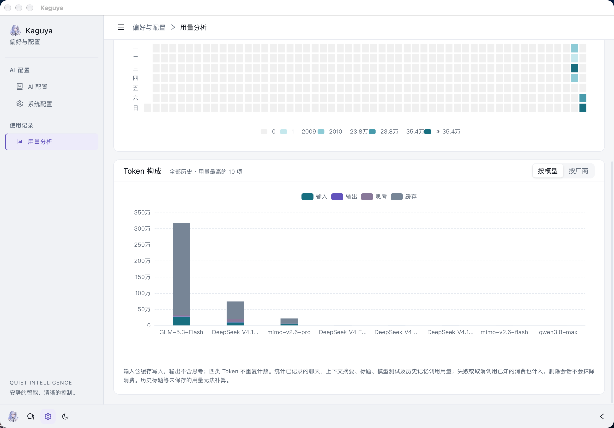

- **Summary cards** (follow the date range): total tokens, daily token peak, total conversations (distinct active conversations), and daily conversation peak.
- **Background-task note**: shows how many tokens background tasks consumed in the range; when background calls returned no confirmable usage, their count is shown and excluded from known totals.
- **Token activity**: always covers the last year in UTC, with daily / weekly / monthly aggregation; the heatmap is colored in quantile buckets and shows exact values on hover.
- **Token composition**: uses all history to show the top ten entries, switchable between by-model and by-provider; a stacked bar chart separates input, output, reasoning, and cache tokens.

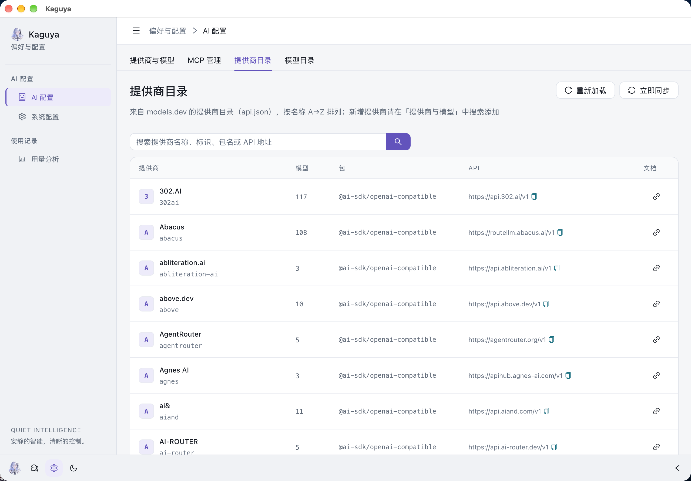

Accounting rules: input includes cache writes, output excludes reasoning, and the four token classes are never double counted. Recorded usage covers chat turns, context summaries, title tasks, model tests, and historical memory calls; failed or canceled calls count when their usage is known; deleting conversations does not remove consumption; calls without returned usage are never given invented token counts; previously unrecorded usage cannot be backfilled. Conversation counts still count distinct conversations with completed turns.

## 7. Runtime behavior and limits

### 7.1 Turn lifecycle

1. Sending first writes a `running` placeholder turn, saved incrementally with throttling while streaming.
2. Only `completed` turns enter full history and usage accounting; `done` is sent after the transaction commits.
3. Disconnects / timeouts mark the turn `interrupted`, user stops mark it `canceled`, generation errors mark it `failed` — all three keep the already streamed content for display.
4. User questions from unfinished turns are appended, in turn order, to the next turn; partial assistant output and tool records never enter the context.
5. The SSE connection is the turn lifecycle: switching conversations does not close it and the turn keeps running; closing the application, refreshing the page, or disconnecting interrupts the current turn.

Chat and title streams validate UTF-8 and limit each unfinished line and event to 64MiB of wire bytes before decoding. Fields, comments, and line endings count toward the event limit; an empty line resets it, so normal heartbeats do not accumulate across the connection. Oversized or malformed input ends the stream. The limit includes more than just data text, so a response exactly at the former text-only boundary may now be rejected. EOF without a terminating blank line does not deliver a partial event; without a valid chat completion event, reload history to confirm the result.

### 7.2 Title generation

Conversation titles are automatically queued by the background-task model when the first turn creates a conversation; the task is independent of chat context and usage, and title failures never affect the conversation. Jobs enter a persistent FIFO queue and run one at a time, so they are never skipped because the worker is busy; the title write and its conversation revision commit in one transaction. After commit, `GET /v1/events` pushes titles and job status. The front end merges their independent revisions and fetches snapshots on connection, reconnection, and newly loaded conversations, with at most 200 IDs per batch and four concurrent batches. Opening a conversation and completing a turn do not wait for titles. For a default title, choose “补生成标题” (Generate missing title) under “更多会话操作” (More conversation actions); this explicit action uses the existing endpoint with a wait of up to 30 seconds. Queue, generation, or failure status appears beside default titles. Sync errors are shown separately and neither replace chat errors nor block list pagination.

### 7.3 Context compaction

- Occupancy comes from the latest model call, never from cumulative consumption.
- At the threshold, the current chat model (without tools) summarizes earlier content while recent messages and the original history are kept; tool calls and results stay paired.
- Summary usage counts toward that turn, including cache writes; the summary is saved transactionally with the successful turn and reused on continuation.
- If reference preparation or a later summary fragment fails, history separately shows already reported summary usage and the number of calls without reported usage. Failed preparation does not enter the conversation's completed-turn totals or create a successful continuation snapshot.
- Unknown model windows skip compaction; compaction failures are reported explicitly rather than silently degraded.

### 7.4 Tool execution and permission boundaries

- File tools (`read` / `edit` / `write`) are constrained with `os.Root`, rejecting outside-workspace paths and symlink escapes; reference resolution reuses the same root confinement.
- `bash` runs with the service process permissions; cancellation stops the process group but does not undo side effects; edits to the same file are serialized. Permission modes are not an OS sandbox: full access keeps host command permissions.
- In restricted modes every registered tool (built-in, MCP, memory) passes through the same approval decorator; provider-executed tools cannot be approved locally, so restricted modes stop the turn and report unsupported instead.
- All Bash calls require approval as unknown side effects in restricted modes, including `pwd` and `true`: inherited host environment, exported functions, and startup scripts mean a command name cannot prove read-only execution. Tool classification uses trusted registration identity; model-provided names and MCP read-only hints never exempt a call from approval.
- Output truncation: `read` returns at most 2000 lines / 50 KB per call; `grep` returns at most 100 matches (adjustable) or 50 KB with long lines cut to 500 characters; `bash` shows only the last 2000 lines / 50 KB and writes the full output to the conversation temp directory.
- Logs never contain raw commands or file contents; approval audit records never contain command or argument bodies.

### 7.5 MCP runtime

- Three transports: `stdio`, `streamable-http`, `sse`.
- HTTP requests stay same-origin with the configured URL; cross-origin redirects and HTTPS downgrade are refused.
- Lists and logs never return environment variables or auth headers; the edit dialog shows stored values so they can be changed, and they are never written to logs.
- New configurations start disabled; editing an enabled service validates the replacement connection first; disabling or deleting closes the connection and cancels requests.
- An enabled service whose startup restore failed or whose connection dropped is reconnected automatically by a background supervisor: exponential backoff of 1s, 2s, 4s… checked every 2 seconds, capped at 60s. After five consecutive failures the circuit opens and automatic retries stop, and the open circuit survives a restart; “重新连接” starts a new cycle manually. Retries stop once the service is disabled or deleted.

- Connections and HTTP requests belong to this application's root context. A successful connection survives completion of its enable/edit request; application shutdown cancels and closes the transport/session. Initialization is limited to 15 seconds; shutdown includes bounded cancellation and cleanup, without promising hard real-time termination of arbitrary host I/O.
- Failure counts, backoff, and circuit state are published only after persistence is confirmed. A storage failure preserves the last confirmed values and blocks automatic recovery in this process. A restart reads only the actual saved state and cannot recover every unpersisted attempt; server logs retain safe classifications rather than raw driver errors, URLs, auth headers, or remote errors.

### 7.6 Model requests

- Final request URL = provider Base URL + model request path; the request path may be any full path starting with `/`.
- Provider type `opencode-go` adds the session ID in the `x-opencode-session` header.
- Chat retries are controlled by “聊天最大重试次数” and never restart after content has been emitted.

## 8. Local data, backups, and security

| Item | Default location / behavior |
| --- | --- |
| Database | `~/.kaguya/kaguya.db`, SQLCipher-encrypted SQLite in WAL mode |
| Database key | `~/.kaguya/kaguya.key`, generated on the first start of a fresh installation |
| Providers, models, MCP, system settings, conversations | Stored in the database |
| Custom database location | `--db.path` / `DB_PATH` |
| Custom key file | `--db.key-file` / `DB_KEY_FILE`; the specified file must already exist |
| Independent API key encryption key | `--secret-key` / `KAGUYA_SECRET_KEY`; derived from the database key when unset |

Database lock waits are limited to 1 second. The single application connection serializes local writes; competing writers fail instead of extending the title cleanup budget. Context deadlines are cooperative, and worker completion is awaited before closing the database.

For backups, quit the application, copy the database and any remaining WAL/SHM files, and store the key separately and securely, along with an independent encryption key if configured. Losing the key makes the data unreadable. Never replace the key for an existing database, and never open the same database in Desktop and Web modes simultaneously. File encryption cannot replace host access protection when both the database and key are lost or stolen together.

API keys use AES-256-GCM (`enc:v2:`). Legacy credentials require the offline migration tool in [cmd/migrate-provider-secrets](../cmd/migrate-provider-secrets/) run against a database copy; startup never rewrites old data in place.

## 9. Installing, building, and run modes

Build dependencies: the Go version in [go.mod](../go.mod), Bun, Make, Git, Xcode Command Line Tools, Tcl, pkg-config, curl, and Perl; on macOS `brew install pkgconf tcl-tk` installs the extras. The native desktop host and packaging currently support **macOS 14 and later**.

```sh
git clone https://github.com/lyonmu/kaguya.git
cd kaguya
make package-macos      # assembles target/Kaguya.app
make dmg-macos          # builds the drag-to-install target/Kaguya-<version>.dmg
```

| Command | Description |
| --- | --- |
| `make build` | Builds and embeds the frontend, outputs `target/<repo directory name>` |
| `make backend` / `make frontend` | Backend-only build / prepares embedded frontend assets |
| `make native` | Downloads and verifies pinned OpenSSL and SQLCipher sources, builds static libraries into `target/` |
| `make install` | Builds and installs the CLI entry at `~/.local/bin/<repo directory name>` (directory must exist) |
| `make test` | `go test -race -count=1 ./...` |

Signing and notarization take their identity from the release environment: `CODESIGN_IDENTITY=... make sign-macos`; `CODESIGN_IDENTITY=... NOTARY_PROFILE=kaguya make notarize-macos` (notarizes and staples both the app and the DMG). Ordinary packaging targets apply an ad-hoc signature to the app bundle, which does not establish Apple developer trust; if the first launch is blocked, allow it under “System Settings → Privacy & Security → Open Anyway”.

### Run modes

- **Desktop (default)**: the same Go services are called through Wails' native asset channel, with no local listening port; external links open in the system browser and copying uses the system clipboard. Launched from Finder, the app tries to load the complete exported environment from `~/.zshrc` through a login shell (5 second timeout), keeping the existing environment on failure.
- **Web (optional)**: `./target/kaguya --web` starts the HTTP service on [http://127.0.0.1:9024](http://127.0.0.1:9024) by default, API prefix `/kaguya/api`; `--host` / `--port` / `--trusted-host` apply only to this mode. Remote access should sit behind an authenticated HTTPS gateway that preserves the original Host / Origin / Sec-Fetch-Site and allowlists the exact hostname with `--trusted-host`. Swagger defaults to `/kaguya/api/swagger/index.html`, Prometheus metrics to `/kaguya/api/metrics`.

Model and remote MCP requests use the network as configured; Bash, Git, and other project tools must be installed on the host.

## 10. Project structure and development

```text
Desktop window / optional Web interface
        │ JSON + POST SSE
        ▼
Go startup and routes → application services → Fantasy Agent → model providers
                              ├── project file tools / MCP tools
                              └── Ent → local SQLCipher database
```

| Path | Responsibility |
| --- | --- |
| `main.go`, `internal/cmd/`, `internal/config/` | CLI, runtime modes, shared initialization and shutdown |
| `internal/desktop/` | Native window, asset channel, system integration, startup environment |
| `internal/router/`, `internal/api/`, `internal/dto/` | Routes, request handling, data contracts |
| `internal/service/agent/` | Chat, history, titles, instruction snapshots, context compaction |
| `internal/service/project/` | Project management, file browsing, Git diffs |
| `internal/service/system/` | Providers, models, MCP configuration, settings, usage |
| `internal/agent/runtime/`, `internal/agent/token/` | Fantasy model execution and usage recording |
| `internal/agent/tools/`, `internal/agent/mcp/` | Built-in file/command tools and MCP connection lifecycle |
| `internal/db/`, `internal/secret/`, `internal/ent/schema/` | Database, credential encryption, handwritten schemas |
| `web/` | React / TypeScript interface and tests |
| `build/darwin/`, `scripts/` | Desktop resources, native dependencies, packaging scripts |
| `docs/` | Generated Swagger documentation and this wiki |

```sh
make test                 # SQLCipher + Go race tests
cd web
bun install --frozen-lockfile
bun run test
bun run lint
bun run build
```

For frontend development, run `./target/kaguya --web` from the repository root, then `bun run dev` inside `web/`. Desktop loads embedded assets, so rebuild and restart after frontend changes. After changing schemas in `internal/ent/schema/`, run `go generate ./internal/ent`. Collaboration and validation conventions live in [AGENTS.md](../AGENTS.md).

## Name and license

Kaguya takes its name from Kaguya-hime (辉夜姬), also echoing the Japanese branch's AI system in *Dragon Raja* (《龙族》).

[MIT](../LICENSE).
